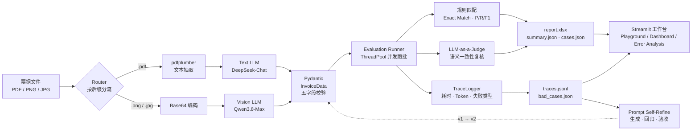
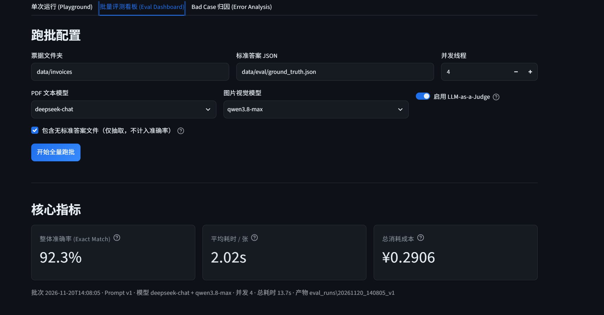
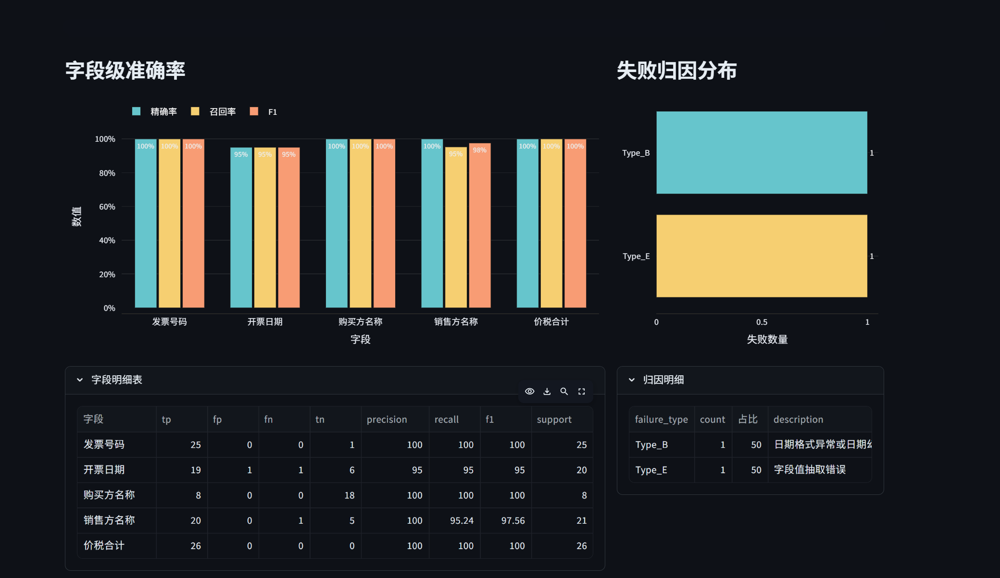
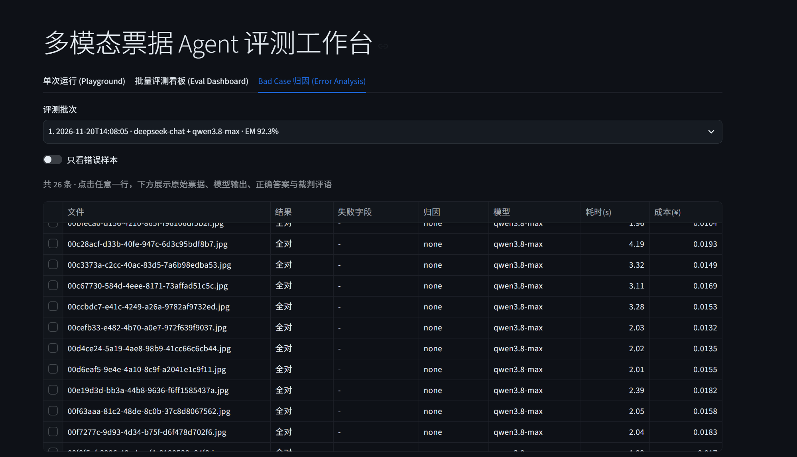
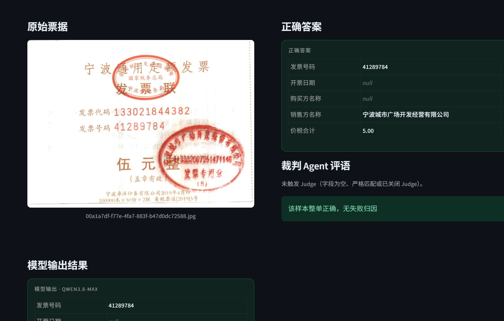

# 多模态票据 Agent 评测工作台

> 一个仓库同时回答两个问题：票据信息**抽得准不准**，以及**为什么不准**。PDF 走文本链路、图片走视觉链路，统一输出五字段结构化结果，并给出可复现的准确率、耗时与成本账本。


---

## 核心特性

- **双轨路由**：按文件后缀分流。PDF 先用 `pdfplumber` 抽出文本交给 DeepSeek-Chat，图片直接以 Base64 送 Qwen3.8-Max 视觉模型。两条链路共用同一份 System Prompt 与同一套 Schema，切换模型只改 `.env`。
- **结构化输出**：Pydantic v2 定义 `invoice_number / issue_date / buyer_name / seller_name / total_amount` 五个字段；日期兼容 `2024-03-08`、`2024年3月8日`、`20240308`，金额自动剥离千分位与货币符号；字段缺失保留 `null`，禁止模型臆造。
- **自动评测**：线程池并发跑批，输出整单完全正确率、字段级 Precision/Recall/F1、P99 耗时、Token 与人民币成本；语义相同但格式不同的值交给 LLM-as-a-Judge 复核，裁判本身用 40 条人工标注校准集验证 Cohen's Kappa。
- **可视化看板**：Streamlit 三个 Tab —— 单次运行、批量评测看板、Bad Case 归因，深色主题，图表用 Plotly，跑批结果与 Trace 全程留在会话内可下钻。
- **失败归因与 Prompt 自迭代**：每次调用结构化落盘 `traces.jsonl`，失败样本按 `Type_A ~ Type_G` 打标签；`run_self_refine.py` 把 Bad Case 喂给反思模型生成新 Prompt，自动回归验收，只有准确率提升且无回退才采用。

## 技术架构



## 快速开始

```bash
# 1. 安装依赖
python -m venv .venv
# Windows
.\.venv\Scripts\activate
# macOS / Linux
# source .venv/bin/activate

pip install -r requirements.txt
```

```bash
# 2. 配置密钥：复制模板后填入真实值（.env 已在 .gitignore 中）
cp .env.example .env
```

```ini
DEEPSEEK_API_KEY=sk-your-deepseek-key
DASHSCOPE_API_KEY=sk-your-dashscope-key
DASHSCOPE_BASE_URL=https://dashscope.aliyuncs.com/compatible-mode/v1
```

```bash
# 3. 启动可视化工作台
streamlit run app.py
# 打开 http://127.0.0.1:8501
```

> 视觉链路默认使用 `qwen3.8-max`，若使用百炼业务空间，记得把 `DASHSCOPE_BASE_URL` 换成该空间的专属域名。

## 效果展示

**批量评测看板**：一次跑批后的整单准确率、平均耗时、总成本与版本留痕。



**字段级指标与失败归因**：每个字段的 Precision / Recall / F1，以及失败类型的分布。



**Bad Case 归因**：列表按样本逐行展示结果、失败字段、归因、耗时与成本。



**单条下钻**：左侧原票，右侧标准答案、裁判评语与模型输出，红绿对比一眼定位差异。



## 评测口径

| 指标 | 口径 |
| --- | --- |
| Exact Match | 五个字段全部匹配的样本占比；匹配包含规则归一与 Judge 复核 |
| 字段级 P / R / F1 | 以有标准答案的样本为分母，逐字段统计 TP / FP / FN |
| P99 耗时 | 抽取链路端到端耗时的 99 分位，含网络往返 |
| Token 成本 | 输入 / 输出 Token × 模型单价，按人民币计 |
| Cohen's Kappa | 裁判判定与人工标注的一致性，剔除随机一致的部分 |

## 命令行

```bash
# 批量评测：生成 report.xlsx / summary.json / traces.jsonl / bad_cases.json
python run_eval.py --data-dir data/invoices --ground-truth data/eval/ground_truth.json --workers 4

# 缺少标准答案的文件只做抽取、不计入准确率
python run_eval.py --data-dir data/invoices --ground-truth data/eval/ground_truth.json --include-unlabeled --no-judge

# 裁判校准：输出准确率与 Kappa
python judge.py --calibration data/eval/judge_calibration.jsonl --judge-model deepseek-chat

# Prompt 自迭代：基于基线跑批的 Bad Case 生成新 Prompt 并回归验收
python run_self_refine.py --baseline-run eval_runs/20261120_135947_v1 --workers 4
```

## 目录结构

```text
lift/
├── app.py                  # Streamlit 工作台（三个 Tab）
├── run_eval.py             # 批量评测 CLI
├── judge.py                # 裁判校准 CLI
├── run_self_refine.py      # Prompt 自迭代 CLI
├── invoice_agent/
│   ├── router.py           # 文件类型路由
│   ├── extractors/         # PDF 文本链路 / 图片视觉链路
│   ├── llm/                # OpenAI 兼容客户端与模型注册表
│   ├── evaluation/         # 评测执行器与 Pandas 报表
│   ├── judge.py            # LLM-as-a-Judge 与 Kappa
│   ├── refine.py           # Prompt 反思与验收策略
│   ├── tracing.py          # Trace 结构与失败类型定义
│   └── schemas.py          # Pydantic 输出模型
├── tests/                  # pytest 单元测试
├── assets/                 # README 截图
├── requirements.txt
└── .env.example
```

## 测试

```bash
pytest -q
```

## 说明

- `data/`、`eval_runs/`、`.env` 均不入库。仓库不含票据样本与密钥，运行前请自备数据目录，并按下面的结构提供标准答案：

```json
{
  "inv_001.pdf": {
    "invoice_number": "24312000000012345601",
    "issue_date": "2024-03-08",
    "buyer_name": "北京星河智联科技有限公司",
    "seller_name": "上海云帆商贸有限公司",
    "total_amount": "1060.00"
  }
}
```

- 缺少标准答案的文件默认跳过；加上 `--include-unlabeled` 或勾选看板中的同名选项，会照常抽取并记录耗时成本，但不计入准确率。
- 裁判模型与抽取模型相互独立，`JUDGE_MODEL` 可单独指向更强的模型；更换裁判后建议重跑 `judge.py` 校准。
